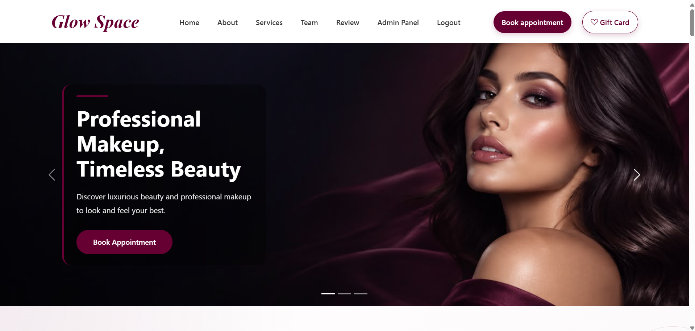
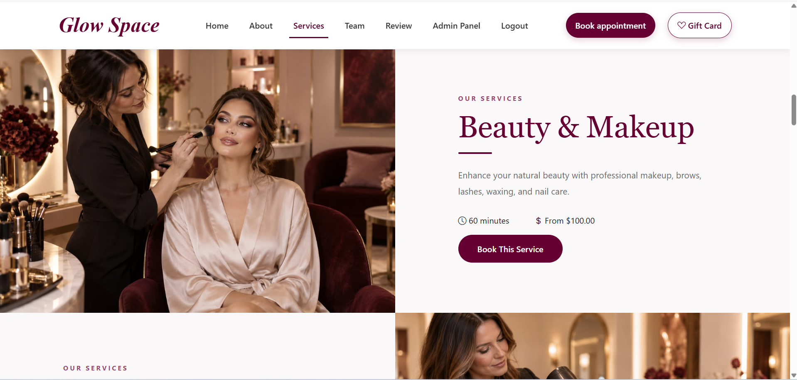
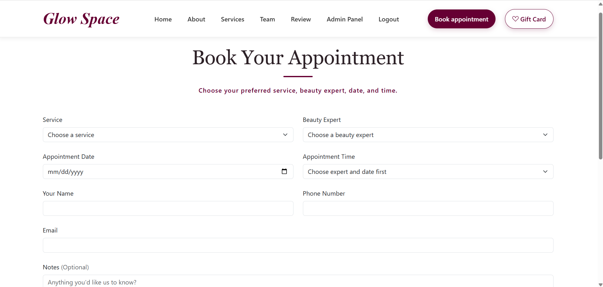
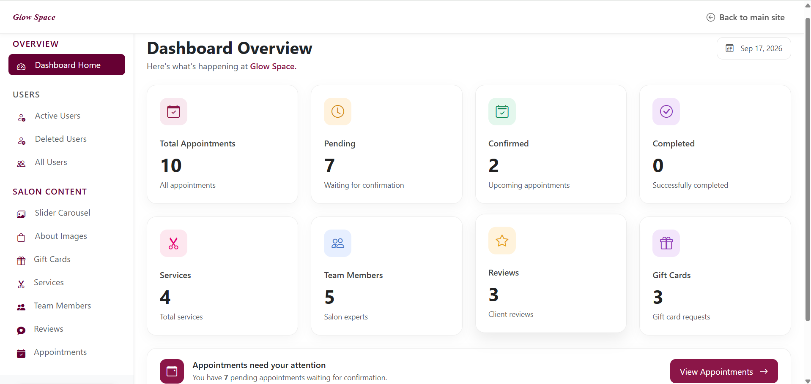

# Glow Space — Beauty Salon Website

Glow Space is a full-stack beauty salon website built with Laravel. It allows customers to explore salon services, meet the beauty experts, book appointments, purchase gift cards, and submit reviews.

The project also includes an admin dashboard for managing the website’s content and customer requests.

## Screenshots

### Home Page



### Services



### Appointment Booking



### Admin Dashboard



## Features

- Responsive and elegant salon interface
- User registration and authentication
- Online appointment booking
- Experts filtered by selected service
- Available times based on expert and date
- Services and beauty experts management
- Customer review submission and admin approval
- Gift card purchasing system
- Dynamic homepage carousel and About section
- Admin dashboard for managing website content

## Technologies Used

- PHP
- Laravel
- Blade
- MySQL
- HTML5
- CSS3
- JavaScript
- Bootstrap
- Git and GitHub

## Installation

1. Clone the repository:

```bash
git clone https://github.com/sarahhariri/glow-space-salon.git